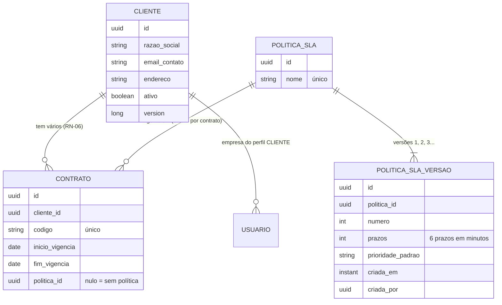
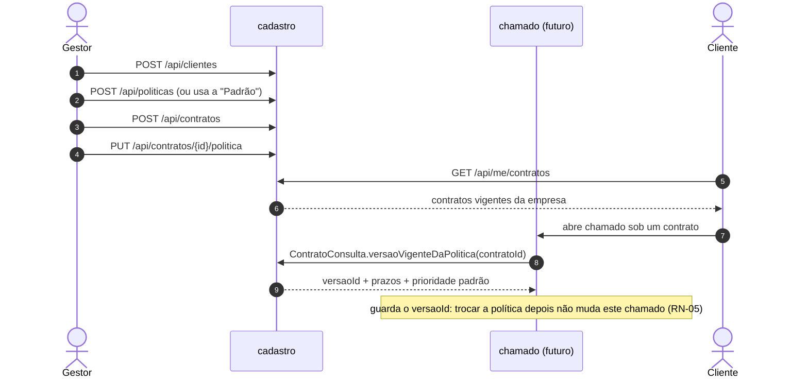

# Convenções do cadastro: clientes, contratos e políticas de SLA

Este documento descreve o módulo `cadastro`: o que ele guarda, as regras que aplica, todos os endpoints e o que ele oferece aos outros módulos. É a referência para o frontend e para quem implementa os módulos que dependem dele, em especial o `chamado`.

Tasks de origem: [cadastro - 01] a [cadastro - 04] (`docs/tasks/cadastro/`). Regras do spec: RF-05 a RF-08, RF-11, RN-01 a RN-08, RN-16, RN-28 a RN-32 e RN-121 (`docs/flowSLA.md`).

## 1. Visão geral

O cadastro é a base de tudo o que o chamado usa:

- **cliente:** a empresa contratante;
- **contrato:** o acordo com um cliente, com vigência;
- **política de SLA:** os prazos dos três relógios por prioridade, com versões imutáveis.

Um chamado só nasce sob um contrato vigente que tenha política vinculada, e guarda a versão da política usada na abertura.

### Modelo



### Do cadastro à abertura do chamado



## 2. Regras de negócio

### 2.1. Cliente

| Regra | Como é aplicada |
| --- | --- |
| Razão social, e-mail de contato e endereço são obrigatórios (RN-08) | Validação do corpo: 400 `VALIDACAO`. UF com 2 letras maiúsculas; CEP com 8 dígitos, sem traço. |
| O e-mail de contato recebe todas as notificações por e-mail do cliente (RN-08) | `ClienteConsulta.emailContato`, usado pelo outbox. O e-mail pode repetir entre clientes. |
| Cliente nunca é apagado (RN-07) | Não existe `DELETE`. Inativar preserva contratos, usuários e chamados. |
| Cliente inativo não aceita novo contrato nem novo usuário | 422 `CLIENTE_INATIVO`. Os usuários do cliente são inativados pelo evento `ClienteInativado`. |
| Edição concorrente (RN-117) | O `PUT` exige a `version` vista; se outro gestor salvou antes, 409 `CONFLITO_VERSAO`. |

### 2.2. Contrato

| Regra | Como é aplicada |
| --- | --- |
| Um cliente pode ter vários contratos ao mesmo tempo (RN-06) | Sem restrição de sobreposição. |
| Código único no sistema | 409 `CODIGO_CONTRATO_JA_EXISTE`. |
| Fim não pode ser anterior ao início | 400 `VALIDACAO` no campo `fimVigencia`. Contrato de um dia só (início = fim) é válido. |
| Vigência por data, inclusiva, no fuso do sistema (RN-01) | Vale do primeiro instante do início até 23:59:59 do fim, no fuso `FUSO_HORARIO` (hoje `America/Fortaleza`). "Hoje" vem do `Clock`. |
| Uma política por vez (RN-02) | Coluna `politica_id`. Vincular outra substitui a anterior. |
| Sem política não recebe chamados (RN-03) | Contrato nasce sem política. A consulta do chamado lança `CONTRATO_SEM_POLITICA`. |
| Não há edição nem remoção de contrato | Não fazem parte das tasks atuais. |

### 2.3. Política de SLA

| Regra | Como é aplicada |
| --- | --- |
| Prazos por prioridade para os três relógios (RN-28) | Cada versão tem `alta` e `normal`, cada uma com `resposta`, `campo` e `resolucao`. |
| Prazos em minutos de janela, nunca em dias corridos (RN-29) | A API recebe e devolve minutos. Um dia útil = 540 minutos (08h às 17h). A conversão para "dias úteis" é do frontend. |
| resposta < campo < resolução, em cada prioridade (RN-30 a RN-32) | 422 `ORDEM_PRAZOS_INVALIDA`, com a prioridade na mensagem. Igualdade também é rejeitada. No banco, um CHECK repete a regra. |
| Prioridade padrão (RN-16) | `prioridadePadrao` (`ALTA` ou `NORMAL`) em cada versão; vale enquanto o gestor não define a prioridade do chamado. |
| Alterar gera nova versão; a anterior nunca muda (RN-04) | Não existe `PUT` nem `DELETE`. A versão é `@Immutable`, e um trigger no banco rejeita `UPDATE`, `DELETE` e `TRUNCATE`, inclusive por SQL direto. |
| Nome único e fixo | 409 `NOME_POLITICA_JA_EXISTE`. A versão nova não muda o nome. |
| Política padrão (seção 5.4) | Criada pela migração `V8`: nome `Padrão`, id `0199a000-0000-7000-8000-00000000c001`, versão 1 com os valores abaixo. |

Política padrão, versão 1 (`prioridadePadrao: NORMAL`):

| Relógio | Alta | Normal |
| --- | --- | --- |
| Resposta | 120 (2 h) | 540 (1 dia útil) |
| Atendimento em campo | 540 (1 dia útil) | 1620 (3 dias úteis) |
| Resolução | 1080 (2 dias úteis) | 2700 (5 dias úteis) |

### 2.4. Auditoria (RN-121)

Gravada na mesma transação da operação (RN-120), sem dado pessoal (RN-122).

| Operação | `operacao` | `entidade_tipo` / `entidade_id` | `dados` |
| --- | --- | --- | --- |
| Cada versão nova de política, inclusive a 1 | `ALTERACAO_POLITICA` | `POLITICA_SLA` / id da política | `{versao, versaoId}` |
| Vincular ou trocar a política do contrato | `ALTERACAO_POLITICA` | `CONTRATO` / id do contrato | `{politicaAnterior, politicaNova}` (`politicaAnterior` nula no primeiro vínculo) |

Não geram auditoria: cliente (fora da RN-121), cadastro de contrato, a política padrão (é migração) e vincular de novo a mesma política (nada muda).

## 3. Endpoints

Todos ficam sob `/api` e exigem token do Keycloak (`Authorization: Bearer ...`). O papel vem sempre do token (RN-130). Quem não tem o papel recebe 403 `ACESSO_NEGADO` antes de o corpo ser lido. Os erros saem no formato de `docs/erros-api.md`.

| Método e caminho | Papel | Resposta | Task |
| --- | --- | --- | --- |
| `POST /api/clientes` | GESTOR | 201 `Cliente` | cadastro-01 |
| `PUT /api/clientes/{id}` | GESTOR | 200 `Cliente` | cadastro-01 |
| `GET /api/clientes` | GESTOR | 200 página de `Cliente` | cadastro-01 |
| `POST /api/clientes/{id}/inativacao` | GESTOR | 204 | cadastro-01 |
| `POST /api/contratos` | GESTOR | 201 `Contrato` | cadastro-02 |
| `GET /api/contratos` | GESTOR | 200 página de `Contrato` | cadastro-02 |
| `GET /api/me/contratos` | CLIENTE | 200 página de `Contrato` | cadastro-02 |
| `PUT /api/contratos/{id}/politica` | GESTOR | 200 `Contrato` | cadastro-04 |
| `POST /api/politicas` | GESTOR | 201 `Politica` | cadastro-03 |
| `GET /api/politicas` | GESTOR | 200 página de `Politica` | cadastro-03 |
| `POST /api/politicas/{id}/versoes` | GESTOR | 201 `Versao` | cadastro-03 |
| `GET /api/politicas/{id}/versoes` | GESTOR | 200 página de `Versao` | cadastro-03 |

### 3.1. Listagens

Toda listagem é paginada: `?page=0&size=20&sort=campo,asc`, com no máximo 100 itens por página. Campo de ordenação inexistente responde 400 `VALIDACAO`. A resposta segue o formato `PagedModel` do Spring Data:

```json
{
  "content": [ ... ],
  "page": { "size": 20, "number": 0, "totalElements": 2, "totalPages": 1 }
}
```

| Listagem | Ordem padrão | Campos úteis para `sort` (qualquer atributo da entidade é aceito) |
| --- | --- | --- |
| `GET /api/clientes` | `razaoSocial` crescente | `razaoSocial`, `emailContato`, `ativo`, `createdAt` |
| `GET /api/contratos` e `GET /api/me/contratos` | `codigo` crescente | `codigo`, `inicioVigencia`, `fimVigencia`, `createdAt` |
| `GET /api/politicas` | `nome` crescente | `nome`, `createdAt` |
| `GET /api/politicas/{id}/versoes` | `numero` decrescente (a mais nova primeiro) | `numero`, `criadaEm` |

### 3.2. Clientes

**`POST /api/clientes`** — cadastra o cliente, que nasce ativo.

```json
{
  "razaoSocial": "Refrigeração Norte Ltda",
  "emailContato": "contato@norte.com.br",
  "endereco": {
    "logradouro": "Av. Santos Dumont", "numero": "1500", "complemento": "Sala 301",
    "bairro": "Aldeota", "cidade": "Fortaleza", "uf": "CE", "cep": "60150160"
  }
}
```

Resposta 201, com `Location: /api/clientes/{id}`:

```json
{
  "id": "0199...", "razaoSocial": "Refrigeração Norte Ltda", "emailContato": "contato@norte.com.br",
  "endereco": { "logradouro": "Av. Santos Dumont", "numero": "1500", "complemento": "Sala 301",
                "bairro": "Aldeota", "cidade": "Fortaleza", "uf": "CE", "cep": "60150160" },
  "ativo": true, "version": 0
}
```

| Campo | Regra |
| --- | --- |
| `razaoSocial` | obrigatório, até 200 |
| `emailContato` | obrigatório, e-mail válido, até 254 |
| `endereco.logradouro`, `bairro`, `cidade` | obrigatórios, até 200/100/100 |
| `endereco.numero` | obrigatório, até 20 |
| `endereco.complemento` | opcional, até 100 |
| `endereco.uf` | obrigatória, 2 letras maiúsculas (`CE`) |
| `endereco.cep` | obrigatório, 8 dígitos sem traço |

Erros: 400 `VALIDACAO`.

**`PUT /api/clientes/{id}`** — edita. O corpo é o mesmo do `POST` mais a `version` recebida na listagem. Cliente inativo também pode ser editado.

```json
{ "version": 0, "razaoSocial": "...", "emailContato": "...", "endereco": { ... } }
```

Resposta 200 com o cliente e a `version` nova. Erros: 400 `VALIDACAO`, 404 `RECURSO_NAO_ENCONTRADO` e 409 `CONFLITO_VERSAO` (outro gestor salvou antes; recarregue e tente de novo).

**`GET /api/clientes?razaoSocial=&ativo=`** — lista, inclusive inativos.

| Parâmetro | Efeito |
| --- | --- |
| `razaoSocial` | contém o texto, sem diferenciar maiúsculas |
| `ativo` | `true` ou `false`; ausente, traz os dois |

**`POST /api/clientes/{id}/inativacao`** — inativa. É idempotente: repetir responde 204 sem efeito novo. Erros: 404 `RECURSO_NAO_ENCONTRADO`.

### 3.3. Contratos

**`POST /api/contratos`** — cadastra o contrato, sem política.

```json
{ "clienteId": "0199...", "codigo": "CT-2026-001", "inicioVigencia": "2026-01-01", "fimVigencia": "2026-12-31" }
```

Resposta 201, com `Location: /api/contratos/{id}`:

```json
{
  "id": "0199...", "clienteId": "0199...", "codigo": "CT-2026-001",
  "inicioVigencia": "2026-01-01", "fimVigencia": "2026-12-31", "politicaId": null
}
```

| Campo | Regra |
| --- | --- |
| `clienteId` | obrigatório; cliente existente e ativo |
| `codigo` | obrigatório, até 50, único no sistema |
| `inicioVigencia`, `fimVigencia` | obrigatórias, `AAAA-MM-DD`; fim ≥ início |

| Erro | Quando |
| --- | --- |
| 400 `VALIDACAO` | campo ausente ou inválido; `fimVigencia` anterior ao início |
| 409 `CODIGO_CONTRATO_JA_EXISTE` | código já usado |
| 422 `CLIENTE_INEXISTENTE` | `clienteId` não existe |
| 422 `CLIENTE_INATIVO` | cliente inativo |

**`GET /api/contratos?clienteId=&vigente=`** — lista todos os contratos.

| Parâmetro | Efeito |
| --- | --- |
| `clienteId` | só os contratos do cliente |
| `vigente` | `true`: vigentes hoje; `false`: vencidos e futuros; ausente: todos |

**`GET /api/me/contratos`** — para o usuário CLIENTE: só os contratos **vigentes hoje** da empresa dele. A empresa vem do usuário autenticado (RN-126), e qualquer parâmetro de cliente na URL é ignorado. Mesmo formato de página e de item da listagem do gestor. É a lista para o cliente escolher o contrato ao abrir um chamado.

**`PUT /api/contratos/{id}/politica`** — vincula ou troca a política do contrato.

```json
{ "politicaId": "0199a000-0000-7000-8000-00000000c001" }
```

Resposta 200 com o contrato e o `politicaId` novo. Chamados já abertos continuam com a versão da abertura (RN-05).

| Erro | Quando |
| --- | --- |
| 400 `VALIDACAO` | `politicaId` ausente |
| 404 `RECURSO_NAO_ENCONTRADO` | contrato não existe |
| 422 `POLITICA_INEXISTENTE` | política não existe |

### 3.4. Políticas de SLA

**`POST /api/politicas`** — cadastra a política com a versão 1.

```json
{
  "nome": "Contrato Ouro",
  "prioridadePadrao": "NORMAL",
  "prazos": {
    "alta":   { "resposta": 60,  "campo": 300, "resolucao": 900 },
    "normal": { "resposta": 300, "campo": 900, "resolucao": 1800 }
  }
}
```

Resposta 201, com `Location: /api/politicas/{id}`:

```json
{
  "id": "0199...", "nome": "Contrato Ouro",
  "versaoAtual": {
    "id": "0199...", "numero": 1, "prioridadePadrao": "NORMAL",
    "prazos": { "alta": { "resposta": 60, "campo": 300, "resolucao": 900 },
                "normal": { "resposta": 300, "campo": 900, "resolucao": 1800 } },
    "criadaEm": "2026-11-10T21:00:00Z", "criadaPor": "<sub do gestor>"
  }
}
```

| Campo | Regra |
| --- | --- |
| `nome` | obrigatório, até 100, único |
| `prioridadePadrao` | obrigatória, `ALTA` ou `NORMAL` |
| `prazos.alta`, `prazos.normal` | obrigatórios |
| `resposta`, `campo`, `resolucao` | inteiros > 0, em minutos; resposta < campo < resolução |

| Erro | Quando |
| --- | --- |
| 400 `VALIDACAO` | campo ausente, prazo 0 ou negativo, prioridade fora do enum |
| 409 `NOME_POLITICA_JA_EXISTE` | nome já usado |
| 422 `ORDEM_PRAZOS_INVALIDA` | ordem violada em alguma prioridade |

**`POST /api/politicas/{id}/versoes`** — cria a próxima versão. O corpo é o do `POST /api/politicas` sem o `nome`. Resposta 201 com a versão criada (o objeto `versaoAtual` acima, com o `numero` seguinte). Duas versões criadas ao mesmo tempo recebem números seguidos, sem conflito.

Erros: os mesmos do `POST /api/politicas`, exceto o 409, mais 404 `RECURSO_NAO_ENCONTRADO` para política inexistente.

**`GET /api/politicas`** — lista as políticas, cada uma com a `versaoAtual`. A `Padrão` sempre aparece.

**`GET /api/politicas/{id}/versoes`** — histórico de versões, da mais nova para a mais antiga (RF-11). `criadaPor` é nulo na versão 1 da `Padrão`. Erros: 404 `RECURSO_NAO_ENCONTRADO`.

## 4. O que o cadastro oferece aos outros módulos

Outros módulos só importam `com.gestaosla.backend.cadastro.api`.

| Tipo | O que é | Quem usa |
| --- | --- | --- |
| `ClienteConsulta.emailContato(clienteId)` | E-mail de contato, destino dos e-mails do cliente (RN-08) | outbox (`MontadorDestinatarios`) |
| `ClienteConsulta.estaAtivo(clienteId)` | Se o cliente aceita novo usuário, contrato ou chamado | identidade (cadastro de usuário) |
| `ClienteInativado` (evento) | Publicado na transação que inativa o cliente | identidade (inativa os usuários do cliente) |
| `ContratoConsulta.versaoVigenteDaPolitica(contratoId)` | Versão mais recente da política do contrato | chamado (abertura), quando existir |
| `PoliticaDoContrato` | `politicaId`, `versaoId`, `numero`, `prioridadePadrao`, `alta`, `normal` e `prazos(Prioridade)` | idem |
| `Prioridade` (`ALTA`, `NORMAL`) e `Prazos` (`resposta`, `campo`, `resolucao`) | Tipos dos prazos em minutos | chamado e sla |

Para o módulo chamado, na abertura:

1. Conferir a vigência do contrato na data de abertura (RN-01, `CONTRATO_FORA_VIGENCIA`). A regra está em `Contrato.estaVigenteEm`; ainda não há consulta pública para ela, que deve entrar em `ContratoConsulta` junto com a task de abertura.
2. Chamar `versaoVigenteDaPolitica(contratoId)`. `CONTRATO_SEM_POLITICA` já sai como 422 (RN-03).
3. Guardar o `versaoId` no chamado e calcular os prazos com `prazos(prioridadePadrao)` até o gestor definir a prioridade (RN-16).
4. Nunca ler a política de novo para um chamado já aberto: os prazos dele são os da versão guardada (RN-05).

Ciclo entre módulos: o `identidade` já depende do `cadastro.api`, então o cadastro não importa `UsuarioCorrente`. Os controllers leem o usuário por expressão, como `@AuthenticationPrincipal(expression = "empresaClienteId")`. O `ModularidadeTest` reprova a importação.

## 5. Banco

| Migração | O que cria |
| --- | --- |
| `V5__cria_cliente.sql` | `cliente`, com CHECK de UF e CEP, e a FK `usuario.cliente_id` |
| `V7__cria_contrato.sql` | `contrato`, com `codigo` único, CHECK `fim_vigencia >= inicio_vigencia` e índice por cliente |
| `V8__cria_politica_sla.sql` | `politica_sla` (nome único), `politica_sla_versao` (número único por política, CHECKs de positivo e de ordem, trigger de imutabilidade) e a política `Padrão` |
| `V9__adiciona_politica_contrato.sql` | `contrato.politica_id` (FK, nula) com índice |

Nada do cadastro é apagado: não existe remoção de cliente, contrato nem política, e as FKs não têm cascata.

## 6. Como mudar

| Mudança | Onde | Cuidado |
| --- | --- | --- |
| Corrigir prazos de uma política | `POST /api/politicas/{id}/versoes` | Nunca altere a versão no banco; o trigger impede. Chamados antigos ficam com a versão antiga, como deve ser. |
| Mudar a política padrão | Uma versão nova da `Padrão` pela API | Nunca edite a `V8`: migração aplicada não muda. |
| Campo novo em contrato ou política | Migração nova + entidade + DTO | O `OpenApiContratoTest` regenera o `docs/openapi.json` e falha até o arquivo novo ser commitado. Avise o frontend. |
| Prioridade nova | `cadastro.api.Prioridade`, colunas novas em `politica_sla_versao` e o CHECK da ordem | Afeta o chamado e o SLA; exige task própria. |
| Código de erro novo | `CodigoErro` e `docs/erros-api.md` | Código publicado nunca muda de nome. |

## 7. Limites conhecidos

- **Sem edição de contrato:** corrigir código ou vigência ainda não é possível pela API.
- **Sem desvincular política:** só é possível trocar. Um contrato que recebeu política não volta a ficar sem.
- **Vigência sem consulta pública:** o módulo chamado vai precisar dela (seção 4).
- **Política sem desativação:** toda política continua disponível para vínculo.
- **Endpoints verificados por testes de integração, não no dev com token real:** o realm não permite login direto. O roteiro manual está nas seções 4, 4A, 4B e 4C de `docs/plano-testes-manuais.md`.
