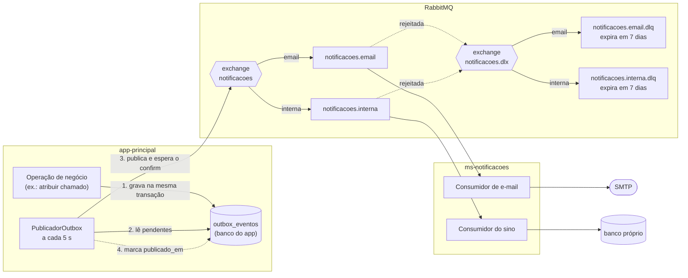

# Convenções do RabbitMQ: outbox e ms-notificacoes

Este documento descreve como o app-principal entrega eventos ao RabbitMQ e o que o ms-notificacoes precisa fazer para consumi-los corretamente. É a referência combinada entre as duas equipes. Mudar algo descrito aqui exige aprovação do backend **e** do ms-notificacoes.

Tasks de origem: [outbox - 01] a [outbox - 04] (`docs/tasks/outbox/`). Regras do spec: RN-46 a RN-58 e RN-113 a RN-116 (`docs/flowSLA.md`).

## 1. Visão geral

O app-principal nunca publica no RabbitMQ durante a operação de negócio. Ele grava o evento numa tabela do próprio banco, na mesma transação da operação, e um publicador agendado o entrega depois. Quem consome as notificações é o ms-notificacoes, que não consulta o app-principal: tudo de que ele precisa chega na mensagem (RN-58).

### Componentes



As linhas tracejadas são caminhos de exceção ou de retorno. A exchange `evidencias` segue o mesmo desenho, com a fila `evidencias.processamento` e a DLQ `evidencias.processamento.dlq` (sem TTL), mas é consumida pelo próprio app-principal (seção 3).

### Sequência de um evento

```mermaid
sequenceDiagram
    autonumber
    participant N as Operação de negócio
    participant T as outbox_eventos
    participant P as PublicadorOutbox
    participant R as RabbitMQ
    participant M as ms-notificacoes

    N->>T: INSERT (mesma transação, RN-113)
    Note over N,T: rollback da operação apaga o evento junto
    P->>T: lê pendentes em ordem de criado_em
    P->>R: publica (mandatory, persistente)
    alt confirmado e com fila de destino
        R-->>P: ack
        P->>T: publicado_em = agora
    else broker fora, sem fila ou sem confirm
        R-->>P: falha
        P->>T: tentativas + 1, ultimo_erro
        Note over P: o ciclo para; tenta de novo em 5 s
    end
    R->>M: entrega na fila do canal
    alt processou
        M->>M: grava eventoId (idempotência)
        M-->>R: ack
    else falha definitiva
        M-->>R: reject sem requeue
        R->>R: encaminha para a DLQ do canal
    end
```

Garantias de ponta a ponta:

| Garantia | Como |
| --- | --- |
| Evento só existe se a operação confirmou | Gravação na mesma transação; rollback apaga os dois (RN-113). |
| Nenhum evento se perde com o broker fora ou a aplicação caindo | O evento fica pendente na tabela até o broker confirmar (RN-114). |
| Nenhuma mensagem se perde por falta de fila | As filas são criadas pelo próprio broker no boot, antes de qualquer serviço (outbox-02). Mensagem sem fila volta ao publicador e conta como falha. |
| Entrega **ao menos uma vez** | Um evento pode chegar mais de uma vez; o consumidor descarta repetições (RN-115, RN-55). |

## 2. Lado do app-principal (o módulo outbox)

### 2.1. Tabela de saída `outbox_eventos`

Criada pela migração `V6__cria_outbox_eventos.sql`.

| Coluna | Uso |
| --- | --- |
| `id` | Chave da linha. |
| `evento_id` | Único. Vai na mensagem como `messageId` e como `eventoId` no payload. |
| `tipo`, `exchange`, `routing_key` | Para onde e como publicar. |
| `payload` (`jsonb`) | Corpo da mensagem, já com o `eventoId`. |
| `criado_em` | Hora do `Clock`; define a ordem de publicação. |
| `publicado_em` | Nulo enquanto pendente; preenchido só depois do confirm do broker. |
| `tentativas`, `ultimo_erro` | Falhas de publicação, para diagnóstico. |

Índice parcial `(criado_em) WHERE publicado_em IS NULL`: o publicador só lê os pendentes, em ordem, sem varrer os já publicados.

### 2.2. Registro do evento

`OutboxService` (`outbox.api`) tem três entradas, todas com `propagation = MANDATORY`. Fora de uma transação, falham com `IllegalTransactionStateException`.

| Método | Uso |
| --- | --- |
| `registrar(EventoNotificacao)` | Notificação; o `eventoId` é gerado. |
| `registrar(EventoNotificacao, eventoId)` | Notificação com id determinístico: violação de SLA (RN-54). |
| `registrar(EventoSaida)` | Evento genérico (ex.: processamento de evidência). |

Gravar de novo um `eventoId` que já existe é ignorado em silêncio (`ON CONFLICT DO NOTHING`). É assim que a mesma violação, detectada duas vezes pela rotina, gera um aviso só.

### 2.3. Publicador (`PublicadorOutbox`)

A cada `app.outbox.publicador.intervalo` (5 s):

1. Lê até 100 pendentes, em ordem de `criado_em`.
2. Publica um por vez e espera a confirmação do broker (até 5 s).
3. Com ack e sem devolução: marca `publicado_em`.
4. Na primeira falha, registra `tentativas` e `ultimo_erro` e **para o ciclo**. O evento é tentado de novo no ciclo seguinte.
5. Se o lote veio cheio, lê o próximo lote no mesmo ciclo.

Contam como falha: broker inacessível, confirm que não chega no prazo, nack e mensagem devolvida por falta de fila (`mandatory=true`).

Consequência que o consumidor precisa conhecer: se a aplicação cair entre o confirm e a marcação, o evento é publicado de novo no próximo ciclo. **Duplicatas acontecem.**

### 2.4. Métricas (RF-64)

| Métrica (Prometheus) | Significado |
| --- | --- |
| `outbox_eventos_pendentes` | Eventos ainda não publicados. |
| `outbox_pendente_mais_antigo_idade_seconds` | Idade do pendente mais antigo; 0 sem pendentes. Crescendo sem parar indica outbox travada. |

As métricas das filas (profundidade, DLQ) vêm do plugin `rabbitmq_prometheus` do broker.

## 3. Topologia

Fonte única: `infra/rabbitmq/topologia.json`, versionada neste repositório. O `rabbitmq-init` junta esse arquivo com o usuário de `.envs/` e grava o `definitions.json`, que o broker carrega no boot (outbox-02).

| Exchange (direct) | Routing key | Fila | Argumentos |
| --- | --- | --- | --- |
| `notificacoes` | `email` | `notificacoes.email` | DLX `notificacoes.dlx`, DLRK `email` |
| `notificacoes` | `interna` | `notificacoes.interna` | DLX `notificacoes.dlx`, DLRK `interna` |
| `notificacoes.dlx` | `email` | `notificacoes.email.dlq` | `x-message-ttl` 604800000 (7 dias, RN-57) |
| `notificacoes.dlx` | `interna` | `notificacoes.interna.dlq` | `x-message-ttl` 604800000 (7 dias, RN-57) |
| `evidencias` | `processamento` | `evidencias.processamento` | DLX `evidencias.dlx`, DLRK `processamento` |
| `evidencias.dlx` | `processamento` | `evidencias.processamento.dlq` | sem TTL (evidência fica em `FALHA`, RN-88) |

Todas as filas são `classic` e `durable`. Uma fila por canal (RN-48): um problema no SMTP não atrasa o sino.

## 4. A mensagem

### 4.1. Propriedades AMQP

| Propriedade | Valor |
| --- | --- |
| `message_id` | `eventoId` (UUID) |
| `type` | tipo do evento (ex.: `ATRIBUICAO`) |
| `content_type` | `application/json` |
| `content_encoding` | `UTF-8` |
| `delivery_mode` | `2` (persistente) |

O Spring AMQP também envia o header `spring_returned_message_correlation`, de uso interno do publicador. O consumidor deve ignorar headers que não conhece.

### 4.2. Tipos e canais

| `tipo` | Canal (routing key) | Destinatários | Campo próprio | Requisito |
| --- | --- | --- | --- | --- |
| `ATRIBUICAO` | `interna` | técnico atribuído ou reatribuído | — | RF-53 |
| `REMOCAO` | `interna` | técnico anterior, removido por reatribuição (sem acesso ao chamado) | — | RF-55, RN-37 |
| `REABERTURA` | `interna` | técnico atribuído | — | RF-54 |
| `CONCLUSAO` | `interna` | gestores com a preferência ativa no chamado | — | RF-57, RN-40 |
| `VIOLACAO` | `interna` | todos os gestores e o técnico atribuído | `relogio` | RF-58, RN-39 |
| `POSICIONAMENTO` | `email` | e-mail de contato do cliente | `textoPosicionamento` | RF-52, RN-53 |
| `RESOLUCAO` | `email` | e-mail de contato do cliente | — | RF-52 |
| `AVISO_ENCERRAMENTO` | `email` | e-mail de contato do cliente | `encerramentoPrevistoEm` | RF-52, RN-34 |

A reatribuição não tem tipo próprio: sai como `ATRIBUICAO` para o técnico novo e `REMOCAO` para o anterior.

### 4.3. Payload

Os JSON Schemas (draft 2020-12) ficam em `contratos/notificacoes/<tipo>.schema.json`, um por tipo. São gerados dos records de `outbox.api.EventoNotificacao` pelo `ContratoNotificacaoTest`. Todo campo é obrigatório, e campo a mais é recusado (`additionalProperties: false`).

| Campo | Tipo | Conteúdo |
| --- | --- | --- |
| `eventoId` | string (`uuid`) | Igual ao `message_id`. Chave de idempotência. |
| `tipo` | string (constante) | Um dos tipos da tabela acima. |
| `chamado.id` | string (`uuid`) | Identificador interno do chamado; é o que o sino usa para levar ao chamado. |
| `chamado.numero` | inteiro | Número legível; exibir como `#1042`. |
| `titulo` | string, não vazia | Título do chamado. |
| `destinatarios` | lista, não vazia | Canal `interna`: `sub` do Keycloak (uuid) de técnicos e gestores. Canal `email`: exatamente 1 e-mail, o de contato do cliente. |
| `relogio` | `RESPOSTA`, `ATENDIMENTO_CAMPO` ou `RESOLUCAO` | Só em `VIOLACAO`: qual SLA foi violado (RN-23 a RN-25). |
| `textoPosicionamento` | string, não vazia | Só em `POSICIONAMENTO`. |
| `encerramentoPrevistoEm` | string (`date-time`, ISO-8601 com fuso) | Só em `AVISO_ENCERRAMENTO`: quando o chamado será validado automaticamente (RN-92). |

Exemplo, notificação interna:

```json
{
  "eventoId": "0199b000-0000-7000-8000-000000000001",
  "tipo": "VIOLACAO",
  "chamado": { "id": "0199b100-0000-7000-8000-000000000042", "numero": 1042 },
  "titulo": "Impressora parada",
  "destinatarios": ["0199a000-0000-7000-8000-000000000001", "0199a000-0000-7000-8000-000000000007"],
  "relogio": "ATENDIMENTO_CAMPO"
}
```

Exemplo, e-mail:

```json
{
  "eventoId": "0199b000-0000-7000-8000-000000000002",
  "tipo": "AVISO_ENCERRAMENTO",
  "chamado": { "id": "0199b100-0000-7000-8000-000000000042", "numero": 1042 },
  "titulo": "Impressora parada",
  "destinatarios": ["contato@boamassa.com.br"],
  "encerramentoPrevistoEm": "2026-11-12T20:00:00Z"
}
```

A ordem das chaves no JSON não é garantida (o payload passa por uma coluna `jsonb`).

### 4.4. O que o payload nunca carrega

- Dado de contrato ou de evidência.
- E-mail de técnico ou gestor; `sub` de cliente (RN-41). O `MontadorDestinatarios` garante isso no app-principal: o canal interno só aceita sub com perfil técnico ou gestor, e o e-mail só sai do cadastro do cliente.
- Nome de pessoa ou outro dado pessoal além do e-mail de contato da empresa cliente.

## 5. O que o ms-notificacoes precisa fazer

| # | Regra | Motivo |
| --- | --- | --- |
| 1 | **Não declarar filas, exchanges nem bindings**, nem mesmo com os mesmos argumentos. Consumir as filas que já existem. | A topologia é única e vem do broker. Uma declaração com argumento diferente falha (`PRECONDITION_FAILED`); com `RabbitAdmin` e beans `Queue`, o Spring declara sozinho. No app-principal isso é barrado pelo `TopologiaRabbitArquiteturaTest`. |
| 2 | Um consumidor por fila: `notificacoes.email` e `notificacoes.interna`. | RN-48. |
| 3 | **Idempotência pelo `eventoId`**: registrar o id só depois do processamento bem-sucedido e descartar repetições. | A entrega é ao menos uma vez (RN-55, RN-115). Registrar antes faria uma falha no meio perder a notificação. |
| 4 | Dar **ack só depois** de gravar a notificação ou enviar o e-mail. | Ack antes perde a mensagem se o serviço cair. |
| 5 | E-mail: falha temporária (timeout, SMTP 4xx) com nova tentativa e backoff, até 3 vezes; falha definitiva (SMTP 5xx) direto para a DLQ. | RN-50. |
| 6 | Mandar para a DLQ = **rejeitar sem requeue** (`basic.reject`/`nack` com `requeue=false`). A fila já encaminha para a DLQ certa. | O roteamento para a DLQ é da topologia (DLX + DLRK). Requeue faria a mensagem voltar em loop. |
| 7 | Circuit breaker do SMTP aberto: **pausar o consumo** da fila de e-mail, sem rejeitar mensagens. | RN-49: as mensagens esperam sem gastar tentativas. |
| 8 | Validar o payload com os schemas de `contratos/notificacoes/`, **com validação de `format` ligada**. Payload inválido: DLQ, sem tentar de novo. | No draft 2020-12, `format` (uuid, email, date-time) é só anotação por padrão; sem ligar, `"amanhã"` passa como data. |
| 9 | Usar `chamado.id` para o link do sino e `chamado.numero` para exibição. Não consultar a API nem o banco do app-principal. | RN-58. A autorização de acesso ao chamado continua no app-principal (RN-45). |
| 10 | Não depender da ordem entre mensagens. | Há uma fila por canal, e uma mensagem pode ser republicada depois de outras. |
| 11 | Ignorar headers AMQP desconhecidos. | Ex.: `spring_returned_message_correlation`. |

DLQs de notificação expiram em 7 dias. Reprocessar uma mensagem da DLQ é operação de manutenção, não funcionalidade do sistema (RN-57).

## 6. Como mudar o contrato ou a topologia

| Mudança | Onde | Cuidado |
| --- | --- | --- |
| Campo novo, removido ou renomeado | Record em `outbox.api.EventoNotificacao` | O `ContratoNotificacaoTest` regenera o schema e falha até o arquivo novo ser commitado. Combinar antes com o ms-notificacoes: consumidor validando com o schema antigo recusa o payload novo. |
| Tipo novo | Record novo + valor no enum `Tipo` | Idem; o ms-notificacoes precisa saber tratar o tipo antes de ele ser publicado. |
| Fila, exchange ou binding novo | `infra/rabbitmq/topologia.json` | Entra no próximo boot do broker. |
| Argumento de fila existente (TTL, DLX) | `infra/rabbitmq/topologia.json` | **A importação ignora em silêncio**: a fila continua com o argumento antigo. É preciso apagar a fila (`rabbitmqctl delete_queue`, que descarta as mensagens dela) e subir o broker de novo. |

Toda mudança desta tabela exige aprovação das duas equipes.

## 7. Operação e diagnóstico

| Sintoma | Causa provável | O que fazer |
| --- | --- | --- |
| `outbox_pendente_mais_antigo_idade_seconds` só cresce | Broker fora, ou um evento sem fila de destino travando o ciclo | Ver `ultimo_erro` do pendente mais antigo: `select evento_id, routing_key, tentativas, ultimo_erro from outbox_eventos where publicado_em is null order by criado_em limit 5;` |
| `ultimo_erro` "Sem fila de destino" | Routing key fora da topologia | Corrigir a topologia ou apagar o evento. Enquanto ele existir, os eventos posteriores esperam (a ordem de criação é preservada). |
| Mensagens acumulando em `notificacoes.*` | ms-notificacoes parado ou com o circuit breaker aberto | Esperado: elas aguardam. Nada se perde. |
| Mensagens em `notificacoes.*.dlq` | Falha definitiva no consumidor | Ver o motivo no ms-notificacoes; elas expiram em 7 dias. |
| Notificação duplicada para o usuário | Consumidor sem idempotência | Ver a seção 5, regra 3. |

Para testar à mão, ver as seções 7B e 7C de `docs/plano-testes-manuais.md`.

## 8. Limites conhecidos

- **Ainda não há produtor de notificação:** os contratos e a outbox estão prontos, mas os eventos nascem nas tasks de chamado, SLA e encerramento automático.
- **`/actuator/prometheus` exige token:** a `SegurancaConfig` libera só `/actuator/health/**`, então um coletor Prometheus sem token não lê as métricas da outbox. A liberação está pendente de decisão.
- **Instância única:** o publicador não tem trava distribuída (RN-116). Rodar duas instâncias do app-principal publicaria eventos em dobro; isso exigiria uma trava (ex.: ShedLock).
- **Um evento travado segura a fila inteira** (seção 7). É consequência de manter a ordem de criação.
