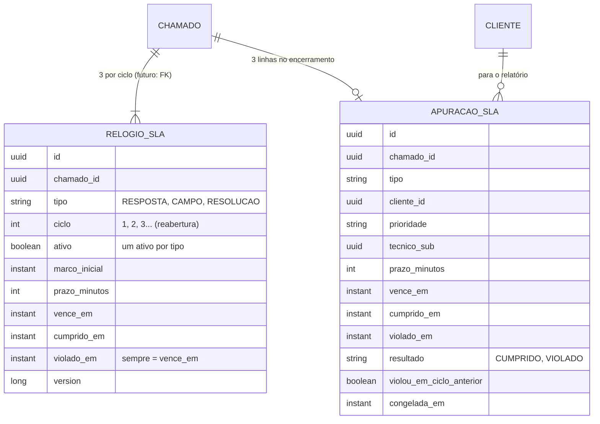

# Convenções do SLA: janela comercial, relógios e apuração

Este documento descreve o módulo `sla`: como os prazos são contados, como os relógios nascem, são cumpridos, violados, recalculados e reiniciados, como a apuração é congelada, o endpoint de consulta e o que o módulo oferece aos outros. É a referência para o frontend e para quem implementa o módulo `chamado`, que é quem aciona o SLA.

Tasks de origem: [sla - 01] a [sla - 05] (`docs/tasks/sla/`). Regras do spec: RF-30 a RF-33, RF-36, RF-37, RN-17 a RN-19, RN-23 a RN-29, RN-54, RN-60 a RN-69, RN-96, RN-97 e RN-126 (`docs/flowSLA.md`).

## 1. Visão geral

O `sla` é uma biblioteca interna do backend. Ele **não sabe o que é um chamado**: guarda relógios e apurações pelo `chamadoId` e devolve as violações para quem chamou. Quem decide quando cada coisa acontece, grava os avisos na outbox e controla o acesso é o módulo `chamado`.

| Peça | O que faz | Task |
| --- | --- | --- |
| `CalendarioJanela` | Soma e conta minutos dentro da janela comercial | sla-01 |
| `RelogiosSla` | Cria, cumpre, recalcula e reinicia os três relógios | sla-02 a sla-04 |
| `ApuracaoSla` | Congela o resultado no encerramento e o consulta | sla-05 |
| `GET /api/chamados/{id}/sla` | Mostra a apuração (fica no módulo `chamado`) | sla-05 |

### Os três relógios

| Relógio (`TipoRelogio`) | Cumprido por | Na notificação |
| --- | --- | --- |
| `RESPOSTA` | primeiro posicionamento do gestor (RN-23) | `RESPOSTA` |
| `CAMPO` | primeiro registro de atendimento presencial do técnico (RN-24) | `ATENDIMENTO_CAMPO` |
| `RESOLUCAO` | chamado passa a RESOLVIDO (RN-25) | `RESOLUCAO` |

### Modelo



### Ciclo de vida de um chamado, do ponto de vista do SLA

```mermaid
sequenceDiagram
    autonumber
    participant CH as chamado (futuro)
    participant CAD as cadastro
    participant SLA as sla
    participant OB as outbox

    CH->>CAD: versaoVigenteDaPolitica(contratoId)
    CH->>SLA: iniciarRelogios(chamadoId, versao, prioridadePadrao, abertura)
    Note over SLA: 3 relógios, ciclo 1
    CH->>SLA: cumprir(chamadoId, RESPOSTA, instante)
    SLA-->>CH: ResultadoCumprimento (violação se atrasou)
    CH->>CAD: versaoDaPolitica(versaoId guardado)
    CH->>SLA: recalcularPorPrioridade(chamadoId, versao, ALTA)
    SLA-->>CH: violações de prazos que já passaram
    CH->>SLA: reiniciarParaReabertura(chamadoId, versao, prioridade, reabertura)
    Note over SLA: CAMPO e RESOLUCAO no ciclo 2; RESPOSTA intacto
    CH->>SLA: congelarApuracao(chamadoId, clienteId, prioridade, tecnicoSub)
    SLA-->>CH: violações marcadas no congelamento
    CH->>OB: grava um evento por violação (eventoId determinístico, RN-54)
```

Todas as chamadas de escrita acontecem **na transação do chamado**: o relógio, a mudança do chamado e o aviso na outbox são gravados juntos ou nenhum é.

## 2. Regras de negócio

### 2.1. Janela comercial (`CalendarioJanela`)

| Regra | Como é aplicada |
| --- | --- |
| Janela de segunda a sexta, das 08h às 17h (RN-60) | 540 minutos por dia útil. Sábado e domingo não contam. |
| No fuso do sistema (RN-62) | O fuso vem do `Clock` (`FUSO_HORARIO`, hoje `America/Fortaleza`), não da JVM. Os testes rodam com a JVM em UTC para provar isso. |
| Início fora da janela começa na próxima abertura (RN-61) | Antes das 08h → 08:00 do mesmo dia; a partir das 17h ou no fim de semana → 08:00 do próximo dia útil. |
| Prazo que termina exatamente no fechamento | Vence às 17:00 desse dia, não às 08:00 do seguinte. |
| Feriados contam como dia útil (RN-63) | Não há calendário de feriados. |
| Prazo em minutos de janela, nunca corridos (RN-29) | Toda conta de vencimento passa por `adicionarMinutos`. |
| Prazo calculado uma vez e gravado (RN-64) | `vence_em` é gravado no relógio; ninguém recalcula na consulta. |

Exemplos (horário de Fortaleza):

| Início | Minutos | Vence em |
| --- | --- | --- |
| segunda 08:00 | 540 | segunda 17:00 |
| segunda 07:00 | 60 | segunda 09:00 |
| segunda 16:00 | 120 | terça 09:00 |
| sexta 16:30 | 60 | segunda 08:30 |
| sábado 10:00 | 540 | segunda 17:00 |

`minutosUteisEntre(inicio, fim)` faz a conta inversa: devolve os minutos de janela entre dois instantes (arredondados para baixo; 0 se `fim` não for depois de `inicio`). Para qualquer início e `n ≥ 0`, `minutosUteisEntre(inicio, adicionarMinutos(inicio, n)) == n`.

### 2.2. Relógios

| Regra | Como é aplicada |
| --- | --- |
| Três relógios por chamado, com prazos da versão da política e da prioridade (RF-30, RN-28) | `iniciarRelogios` cria RESPOSTA, CAMPO e RESOLUCAO no ciclo 1, com `marco_inicial` = abertura. |
| Prazos da versão guardada no chamado (RN-05) | O sla recebe a versão como objeto (`PoliticaDoContrato`); nunca lê a política vigente sozinho. |
| Só o primeiro evento cumpre (RN-23 a RN-25) | `cumprir` grava `cumprido_em` só se ainda estiver nulo. Os seguintes devolvem `cumpriuAgora = false`. |
| Cumprir exatamente no vencimento conta como no prazo | Violação só quando o instante é **depois** de `vence_em` (RN-65 fala em prazo "ultrapassado"). |
| Violação marca o horário real do estouro (RN-67) | `violado_em = vence_em`, nunca o horário da detecção. Um CHECK no banco repete a regra. |
| Um único ponto marca a violação | `RelogioSla.marcarViolacao()`. Não faz nada se o relógio já estiver violado, então o aviso não se repete. |
| Violado continua violado (RN-69) | Cumprido depois de violado: estado `VIOLADO`. |
| Os três violam de forma independente | Cada relógio tem prazo e estado próprios. |
| Um relógio ativo por tipo | Índice único parcial `(chamado_id, tipo) WHERE ativo`. |
| Edição concorrente | `@Version` no relógio. |

Estado derivado (`EstadoRelogio`, não gravado): `VIOLADO` se `violado_em` preenchido; senão `CUMPRIDO` se `cumprido_em` preenchido; senão `CORRENDO`. O "apertando" (perto de vencer) é cálculo do frontend a partir de `venceEm`.

### 2.3. Recálculo por prioridade (sla-03)

| Regra | Como é aplicada |
| --- | --- |
| Prioridade definida ou alterada recalcula os prazos (RF-31, RN-17) | `recalcularPorPrioridade`: prazo novo da mesma versão, contado do `marco_inicial` do próprio relógio. |
| Cumpridos, violados e inativos não mudam (RN-18) | Só relógios ativos e `CORRENDO` são tocados. |
| Depois de uma reabertura, o marco é o da reabertura | O marco é o do relógio ativo, que no ciclo 2 é a reabertura. |
| Prazo novo que já ficou no passado | Violado na hora (`violado_em = vence_em` novo) e devolvido ao chamador para o aviso. |

### 2.4. Reabertura (sla-04)

| Regra | Como é aplicada |
| --- | --- |
| Reabrir reinicia CAMPO e RESOLUCAO (RF-32, RN-96) | `reiniciarParaReabertura`: o ciclo atual vira `ativo = false` e nasce o ciclo seguinte com `marco_inicial` = reabertura. |
| RESPOSTA não reinicia (RN-97) | Não é tocado. |
| O ciclo anterior vira histórico | Continua no banco; `historico(chamadoId)` lista todos os ciclos. |
| Violação pendente do ciclo encerrado não se perde | Se o relógio encerrado estava vencido e a rotina de 15 minutos ainda não tinha passado, ele é violado ao encerrar e a violação é devolvida. |
| Cada ciclo gera o seu próprio aviso (RN-54) | O `eventoId` do aviso usa chamado, tipo e marco inicial; o marco muda a cada ciclo. |

### 2.5. Apuração (sla-05)

| Regra | Como é aplicada |
| --- | --- |
| Encerrar congela o resultado (RF-36, RN-68) | `congelarApuracao` grava uma linha por relógio em `apuracao_sla`, com o último ciclo. |
| A apuração nunca muda | Entidade `@Immutable`; trigger rejeita `UPDATE`, `DELETE` e `TRUNCATE`, inclusive por SQL direto. Chamar `congelarApuracao` de novo não faz nada. |
| Relógio sem evento no encerramento | Dentro do prazo: `CUMPRIDO`. Prazo já vencido: é violado antes de congelar e sai `VIOLADO`. |
| Violação em ciclo anterior conta (RN-69) | `resultado = VIOLADO` e `violouEmCicloAnterior = true`, mesmo que o último ciclo tenha sido cumprido. |
| Dados do relatório copiados no encerramento | `cliente_id`, `prioridade` e `tecnico_sub` vêm do chamador; o relatório não depende do estado atual do chamado. |
| Crédito ao técnico | O técnico responsável no encerramento (`tecnicoSub`, pode ser nulo). |
| Cancelado não é apurado (RN-19) | O chamado não deve chamar `congelarApuracao` ao cancelar; a consulta fica vazia. |
| Política nova depois do encerramento | Não altera nada: a apuração é uma fotografia. |

## 3. Endpoint

Fica sob `/api`, no módulo `chamado`, e exige token do Keycloak (`Authorization: Bearer ...`). O papel vem do token (RN-130). Os erros saem no formato de `docs/erros-api.md`.

| Método e caminho | Papel | Resposta | Task |
| --- | --- | --- | --- |
| `GET /api/chamados/{id}/sla` | GESTOR, TECNICO, CLIENTE | 200 `SlaResponse` | sla-05 |

O sla não tem endpoint próprio: relógios ativos e histórico serão expostos pelo chamado, que é quem controla o acesso.

### 3.1. `GET /api/chamados/{id}/sla`

Resultado de SLA congelado de um chamado (RF-37).

| Quem | Vê |
| --- | --- |
| GESTOR | qualquer chamado |
| CLIENTE | só se o `clienteId` da apuração for a empresa dele; senão 404 (RN-126) |
| TECNICO | só se for o técnico responsável no encerramento; senão 404 |
| Sem apuração (cancelado ou não encerrado) | gestor: 200 `{"apurado": false}`; cliente e técnico: 404 |

Resposta 200 com apuração (horários em UTC; o exemplo é um chamado `NORMAL` aberto segunda, 09/11/2026, às 09:00 de Fortaleza):

```json
{
  "apurado": true,
  "prioridade": "NORMAL",
  "congeladaEm": "2026-11-13T19:00:00Z",
  "relogios": [
    { "tipo": "RESPOSTA", "prazoMinutos": 540, "venceEm": "2026-11-10T12:00:00Z",
      "cumpridoEm": "2026-11-10T11:00:00Z", "violadoEm": null,
      "resultado": "CUMPRIDO", "violouEmCicloAnterior": false },
    { "tipo": "CAMPO", "prazoMinutos": 1620, "venceEm": "2026-11-12T12:00:00Z",
      "cumpridoEm": "2026-11-12T15:00:00Z", "violadoEm": "2026-11-12T12:00:00Z",
      "resultado": "VIOLADO", "violouEmCicloAnterior": false },
    { "tipo": "RESOLUCAO", "prazoMinutos": 2700, "venceEm": "2026-11-16T12:00:00Z",
      "cumpridoEm": "2026-11-13T18:00:00Z", "violadoEm": null,
      "resultado": "CUMPRIDO", "violouEmCicloAnterior": false }
  ]
}
```

Resposta 200 sem apuração (só o gestor):

```json
{ "apurado": false, "prioridade": null, "congeladaEm": null, "relogios": null }
```

| Erro | Quando |
| --- | --- |
| 401 | sem token ou token inválido |
| 403 `ACESSO_NEGADO` | papel fora dos três |
| 404 `RECURSO_NAO_ENCONTRADO` | cliente de outra empresa, técnico que não é o responsável, ou cliente/técnico sem apuração |

## 4. O que o sla oferece aos outros módulos

Outros módulos só importam `com.gestaosla.backend.sla.api`. O sla importa só `cadastro.api` (`Prioridade`, `Prazos`, `PoliticaDoContrato`) e nunca o `chamado`: o `SlaArquiteturaTest` reprova essa dependência.

| Tipo | O que é |
| --- | --- |
| `CalendarioJanela` | `adicionarMinutos(instante, minutos)` e `minutosUteisEntre(inicio, fim)` |
| `RelogiosSla.iniciarRelogios(chamadoId, versao, prioridade, instante)` | Cria os três relógios do ciclo 1 |
| `RelogiosSla.cumprir(chamadoId, tipo, instante)` | Cumpre o relógio ativo do tipo; devolve `ResultadoCumprimento(cumpriuAgora, Optional<Violacao>)` |
| `RelogiosSla.recalcularPorPrioridade(chamadoId, versao, novaPrioridade)` | Recalcula os relógios correndo; devolve as violações marcadas agora |
| `RelogiosSla.reiniciarParaReabertura(chamadoId, versao, prioridade, instante)` | Novo ciclo de CAMPO e RESOLUCAO; devolve violações pendentes do ciclo encerrado |
| `RelogiosSla.relogiosAtivos(chamadoId)` / `historico(chamadoId)` | `RelogioView` com o estado derivado, por tipo e ciclo |
| `ApuracaoSla.congelarApuracao(chamadoId, clienteId, prioridade, tecnicoSub)` | Congela; devolve as violações marcadas no congelamento |
| `ApuracaoSla.consultarApuracao(chamadoId)` | `Optional<ApuracaoChamado>`; vazio = sem apuração |
| `Violacao(chamadoId, tipo, ciclo, marcoInicial, violadaEm)` | O que o chamado precisa para gravar o aviso na outbox |
| `TipoRelogio`, `EstadoRelogio`, `ResultadoApuracao`, `RelogioView`, `ApuracaoChamado` | Tipos de leitura |

Contrato das chamadas:

- **Escrita exige transação.** Os métodos de escrita usam `propagation = MANDATORY`; fora de uma transação lançam `IllegalTransactionStateException`.
- **Violação devolvida = aviso a gravar.** O sla nunca escreve na outbox. Toda `Violacao` devolvida deve virar um evento na mesma transação.
- **Tipo sem relógio ativo** em `cumprir` ou `reiniciarParaReabertura`, ou chamado sem os três relógios em `congelarApuracao`: `IllegalStateException` (erro de programação do chamador, não do usuário).
- **Versão da política:** na abertura, `versaoVigenteDaPolitica(contratoId)`; depois, sempre `versaoDaPolitica(versaoId)` com o id guardado no chamado.

Para o módulo chamado:

1. **Abertura:** `iniciarRelogios` com a versão vigente e a `prioridadePadrao` da versão (RN-16).
2. **Primeiro posicionamento do gestor, primeiro atendimento presencial, RESOLVIDO:** `cumprir` com o tipo correspondente; gravar o aviso se vier violação.
3. **Prioridade definida ou alterada:** `recalcularPorPrioridade` com a versão guardada.
4. **Reabertura:** `reiniciarParaReabertura` com a versão guardada e a prioridade atual.
5. **Encerramento:** `congelarApuracao` com cliente, prioridade e técnico responsável. **Cancelamento:** não chamar.
6. **Rotina de 15 minutos ([chamado - 14]):** ainda não existe; vai precisar de um método novo no sla que viole os vencidos usando `marcarViolacao` (o índice `relogio_sla_correndo_idx` já está pronto para ela).

## 5. Banco

| Migração | O que cria |
| --- | --- |
| `V10__cria_relogio_sla.sql` | `relogio_sla`: UNIQUE `(chamado_id, tipo, ciclo)`, CHECK `violado_em = vence_em`, índice único parcial de um ativo por tipo e índice parcial `relogio_sla_correndo_idx` (ativos sem cumprimento e sem violação, por `vence_em`) |
| `V11__cria_apuracao_sla.sql` | `apuracao_sla`: UNIQUE `(chamado_id, tipo)`, FK para `cliente`, CHECK de coerência do resultado, índices por cliente e por técnico e trigger de imutabilidade |

- **Sem FK para `chamado`** nas duas tabelas: a tabela ainda não existe. A FK entra na migração que criar o chamado (`docs/convencoes-banco.md`).
- `relogio_sla` tem `@Version`; `apuracao_sla` não tem `updated_at` nem `version`, porque nunca muda.
- Na reabertura há um `flush` antes de inserir o ciclo novo: sem ele o Hibernate faria os INSERTs antes dos UPDATEs e o índice único parcial rejeitaria o segundo ativo.

## 6. Como testar

### 6.1. Automatizado

| Comando | Roda |
| --- | --- |
| `make unit-test` | `CalendarioJanelaTest`, `CalendarioJanelaPropriedadesTest`, `RelogioSlaTest`, `SlaArquiteturaTest` |
| `make integration-test` | `RelogiosSlaTest`, `ApuracaoSlaTest` e a rota no `AcessoPorRotaTest` (precisa de Docker) |
| `TZ=UTC ./mvnw clean test` | suíte completa, com a JVM fora do fuso do sistema |
| `./mvnw test -Dtest='CalendarioJanela*,RelogioSla*,RelogiosSla*,ApuracaoSla*,SlaArquitetura*'` | só o SLA |

| Teste | Cobre |
| --- | --- |
| `CalendarioJanelaTest` | casos parametrizados: os da task, domingo, sexta 17:00, início às 17:00, virada de mês e de ano, 25/12 como dia útil, fuso vindo do `Clock` |
| `CalendarioJanelaPropriedadesTest` (jqwik) | `minutosUteisEntre` inverso de `adicionarMinutos`, vencimento sempre dentro da janela, somar em duas etapas = somar de uma vez |
| `RelogioSlaTest` | a entidade: primeiro cumprimento, violação no atraso e no limite, `VIOLADO` permanente, recálculo e encerramento de ciclo |
| `RelogiosSlaTest` | o serviço com banco: abertura com a política `Padrão`, violações independentes, recálculo respeitando a versão antiga, reabertura, histórico, transação obrigatória e índice único |
| `ApuracaoSlaTest` | congelamento, `CUMPRIDO`/`VIOLADO` sem evento, violação em ciclo anterior, idempotência, trigger e o endpoint por papel |
| `SlaArquiteturaTest` | o sla não depende do chamado |

Os testes de integração chamam a API do sla dentro de um `TransactionTemplate`, como o chamado fará, e controlam a hora com o `RelogioMutavel`.

O jqwik grava a sua base em `target/.jqwik-database` (`src/test/resources/junit-platform.properties`).

### 6.2. Manual

Sem o módulo chamado, nada aciona os relógios pela API. À mão dá para conferir só:

- `GET /api/chamados/{uuid qualquer}/sla` como gestor → 200 `{"apurado": false, ...}`; como cliente ou técnico → 404 (`docs/plano-testes-manuais.md`, seção "O que este plano não cobre");
- no psql, que as tabelas e o trigger existem: `\d relogio_sla`, `\d apuracao_sla` e um `update apuracao_sla set resultado = 'CUMPRIDO';` responde "Apuração de SLA congelada não pode ser alterada nem removida (RN-68)."

## 7. Como mudar

| Mudança | Onde | Cuidado |
| --- | --- | --- |
| Horário ou dias da janela | `CalendarioJanela` (`ABERTURA`, `FECHAMENTO`, `diaUtil`) | Prazos já gravados não mudam (RN-64). Atualize os casos e as propriedades do calendário. |
| Feriados | `CalendarioJanela.diaUtil` + tabela de feriados | Hoje RN-63 manda contar como dia útil; exige mudança de regra. |
| Fuso | variável `FUSO_HORARIO` | Vale para o calendário inteiro; nada no código. |
| Relógio novo | `TipoRelogio`, CHECK de `tipo` nas duas tabelas (migração nova), prazos na política (cadastro) e mapeamento na notificação | Afeta cadastro, chamado e outbox; exige task própria. |
| Corrigir uma apuração | Não há caminho | É imutável por regra (RN-68). Desligar o trigger é decisão de negócio, não de código. |
| Prazos de uma política | Versão nova pelo cadastro | Só vale para chamados abertos depois (RN-05). |

## 8. Limites conhecidos

- **O chamado ainda não existe:** nada chama o sla em produção. Relógios, recálculo, reabertura e apuração só rodam nos testes.
- **Sem a rotina de 15 minutos:** um relógio vencido só é violado quando alguém o toca (cumprimento, recálculo, reabertura ou congelamento).
- **Acesso do endpoint pelos dados da apuração:** sem a entidade Chamado, cliente e técnico só enxergam chamados encerrados. Quando o chamado existir, a checagem passa a ser feita por ele.
- **Sem FK para `chamado`** em `relogio_sla` e `apuracao_sla`.
- **Sem feriados** (RN-63).
- **Endpoint verificado por testes de integração, não no dev com token real**, pelo mesmo limite do cadastro. As migrações V10 e V11 foram verificadas num ambiente de dev subido a partir de uma cópia.
